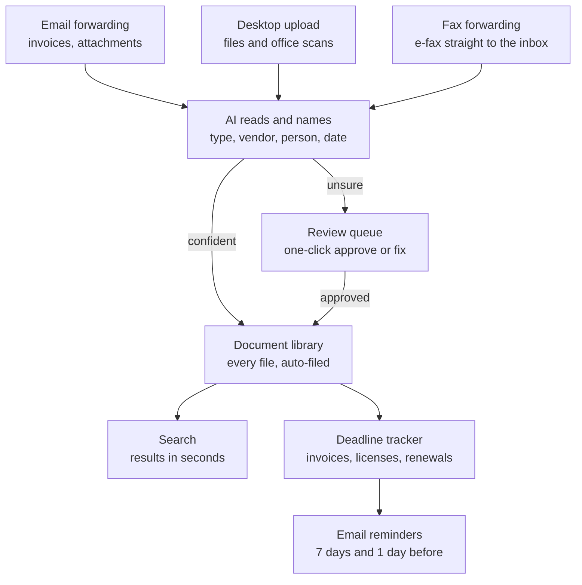

# Sortable PRD

Oct 20, 2026 · @Kate Gabrielsen

## The What: pitch

**Sortable automatically names, files and tracks every document that reaches an independent medical or dental practice, so the practice manager can find anything in seconds and never miss a due date, credential renewal or compliance deadline.**

Target user: the practice manager at an independent medical/dental practice (not part of a hospital system) with 5 to 100 employees and no dedicated HR staff.

**Research status:** Preliminary. This PRD is built on 4 early survey responses. The survey stays open, and we will keep gathering responses and running interviews throughout development, updating this PRD as the evidence grows.

## The Why: problem

Small and mid-sized independent medical and dental practices rarely have strong organizational systems. Tracking employee records and credentialing, invoice payments and insurance policies falls on one overloaded practice manager, who loses 1 to 2 hours every week just filing and finding documents.

### Root causes

1. **No designated HR staff.** HR work falls to the practice manager, who is already taking on tasks outside her designated duties to keep the practice running.

2. **Documents arrive through many channels.** Fax, paper, email and uploads all need to be filed, labelled, organized and monitored by hand.

3. **Enterprise solutions don't fit.** They are too costly and hard to scale down for practices under 100 employees.

### Primary persona

Practice managers at independent medical and dental practices with 5 to 100 employees, no designated HR staff and no established organizational system. Their job spans many functions, and the line between their real responsibilities and what they take on out of operational necessity is often blurred. They are busy, work within a tight budget and have basic technology skills.

**Pain points**

- Hard to keep track of due dates for invoices, payments, employee files and credentialing.

- Hours each week spent uploading, naming, labelling and filing documents, and updating spreadsheets with due dates.

- No visibility into whether employee files are complete; no simple way to see which documents are missing and for whom.

- Managing HR on top of an already busy job.

- Time spent gathering documents for audits, inspections or legal requests.

**Delight points**

- The only action needed is to forward or upload a document; AI labels, categorizes, dates and files it to the right employee or folder.

- A dashboard showing upcoming expiration and renewal dates and the completeness of each employee file.

- Alerts before credentials expire or payments come due.

- Easy access to any document through AI filing and AI-powered search.

- Simple setup and affordable pricing that works alongside the practice's current software.

### What the survey shows

Four practice managers have responded so far: three at dental practices and one at a specialty medical practice. Respondent A (11 to 25 staff, 1 location) owns 9 of 10 admin areas, from HR and payroll to IT and budgeting. B (1 to 10 staff, 6+ locations) rates 6 areas as taking "a lot" of time. C (1 to 10 staff, 2 to 3 locations) owns 9 areas and handles 26 to 50 vendor invoices a month. D (specialty medical, 100+ staff, 6+ locations) owns 9 areas, onboards 16 to 30 hires a year and names HR and employee paperwork as her most frustrating task. D's practice is larger than our 5 to 100 target, but she reports the same deadline and HR pains.

**Where it breaks today.**

- **Scattered intake.** Documents arrive by email attachment (A, D), or as paper handed in and fax (B, C). Vendor invoices arrive by email and mail.

- **Scattered storage.** Files live on a desktop hard drive (A), a shared drive (B), a paper filing cabinet (C) or HR and payroll software (D), alongside spreadsheets, QuickBooks and bank bill pay. A summed it up: "Having things stored in different ways because I don't have one software that works with everything."

- **Real misses in the last 12 months.** All 4 respondents paid an invoice late or were charged a late fee. A also had a document misfiled or lost, a new hire start before paperwork was complete, and a scramble to find documents for an audit or legal request. D had a license, certification or training expire, or an invoice come due, without anyone noticing.

- **Tools that over-promise.** D switched to Paychex PEO hoping for automation: "A lot of promises of automation that never happened."

**Why now.** Practices already pay for office software (\$700 a month at C, about \$1,000 at A and about \$20,000 at D), yet none of their tools (Dentrix, OMSVision, Weave, QuickBooks, Paychex, Jotform, bank bill pay) owns the loose back-office documents between those systems.

**Preliminary research.** These findings come from 4 early survey responses (3 dental practices, 1 specialty medical practice). They are a starting signal, not proof. The survey stays open, and we will keep gathering data throughout development (see Testing plan).

## The Why: the bet

We bet that owning document intake and filing is the wedge into the small-practice back office: every respondent so far rated it 4 or 5, 2 of the 3 who picked top features chose it, and no tool they use covers it.

| Bet part        | What we believe                                                                                                                                                                          | Evidence                                                                                                                                |
|-----------------|------------------------------------------------------------------------------------------------------------------------------------------------------------------------------------------|-----------------------------------------------------------------------------------------------------------------------------------------|
| **Opportunity** | Practice software (Dentrix, OMSVision) runs the clinical side, payroll and accounting tools manage money, but the back-office documents between them have no home.                       | All 4 rated auto-filing and search 4 or 5; 3 of 4 spend 1 to 2 hrs/week filing and searching.                                           |
| **Strategy**    | Win the daily habit first with intake, auto-filing and search. Then expand into deadlines that live inside those documents: invoice due dates, license expirations, compliance renewals. | All 4 had a late invoice or fee; invoice tracking, bill reminders, license alerts and the compliance calendar scored 4 or 5 from all 4. |
| **Solution**    | One inbox that takes email, uploads and faxes; AI names and files each document; a searchable library; a dashboard of upcoming deadlines; and alerts before anything is due or expires.  | Matches intake channels reported (email, paper, fax, mail); auto-filing was a top-3 pick for 2 of the 3 respondents who chose.          |

**How the parts connect.** Filing gives Sortable every document; reading every document lets it find dates; finding dates lets it prevent late fees. Each step makes the next one possible, and the late-fee savings give the owner a reason to pay.

**How this fits our strategy.** Sortable started as an HR-paperwork tool. We kept the survey broad to test that, and the data pointed wider: HR paperwork was a low-time task for A and C (2/5 and 1/5), while cross-category filing and invoices were consistent pains. D, the one medical practice so far, named HR paperwork as her most frustrating task, so HR files remain a core category inside an all-documents product. It is also buildable as a student team with Claude in one semester, since the core is document classification, not a deep system integration.

## Goals and metrics

Sortable succeeds if a pilot practice cuts document time from 1 to 2 hours a week to under 30 minutes and has zero late fees during the pilot. Targets below are for a 4-week pilot with 3 practices; baselines come from our preliminary survey and will be refined as more data comes in.

| Goal                  | Metric                                                               | Baseline                    | Pilot target     |
|-----------------------|----------------------------------------------------------------------|-----------------------------|------------------|
| Save the manager time | Self-reported hours/week filing and finding documents                | 1 to 2 hrs (3 of 4)         | under 30 min     |
| Filing they can trust | % of documents auto-filed with no correction                         | n/a (manual today)          | 90% or more      |
| Find anything fast    | Median time from search to opening the right file                    | not measured                | under 15 seconds |
| No missed deadlines   | Invoices paid late or charged a late fee                             | at least 1 per year (all 4) | 0 during pilot   |
| Becomes a habit       | Practices using Sortable 4+ days/week (weekly active)                | 0                           | 3 of 3           |
| Fast setup            | % of practices that connect email and file a first document on day 1 | 0                           | 100%             |
| Worth paying for      | Pilot practices that agree to a paid plan                            | 0                           | 2 of 3           |
| People like it        | NPS from managers at end of pilot                                    | none                        | 40 or higher     |

**North-star metric:** documents auto-filed per practice per week, because it rises only when documents flow in and the filing is trusted.

## Risks and assumptions

The biggest risk is that filing is a real pain but not the most urgent one: 3 of 4 respondents named insurance billing and claims as their single most frustrating task (the fourth named HR paperwork).

| Risk                                                                                               | Probability | Consequence if it happens                                | Mitigation                                                                                                                       |
|----------------------------------------------------------------------------------------------------|-------------|----------------------------------------------------------|----------------------------------------------------------------------------------------------------------------------------------|
| Managers value filing but won't pay, because insurance claims hurt more (top pain for 3 of 4)      | High        | Weak willingness to pay; slow sales                      | Price against late fees and hours saved; ask about price in every follow-up call; keep claims on the watch list                  |
| Preliminary sample of 4 (3 dental, 1 medical) does not represent the market                        | High        | We build for the wrong user or feature set               | Keep the survey open and keep gathering data; reach 15+ responses, at least 5 from medical practices, before locking scope       |
| Documents contain personal employee data                                                           | High        | Legal exposure; practices refuse to adopt                | Encrypt documents at rest and in transit; role-based access so only authorized staff see employee files; log who opens each file |
| The manager is not always the buyer (owner decides at 2 of 4 practices)                            | Medium      | Long sales cycle; manager champions but can't buy        | Pitch owners directly on late fees avoided and hours saved                                                                       |
| Paper-first offices (2 of 4 get paper or fax; 1 keeps a paper cabinet)                             | High        | Part of the paperwork stays outside Sortable             | E-fax forwarding address and upload of office-scanner files in MVP                                                               |
| AI misfiles documents                                                                              | Medium      | Manager stops trusting Sortable and goes back to folders | Low-confidence documents go to a review queue; one-click correct; learn from corrections                                         |
| Practices expect integration with their practice or payroll software (Dentrix, OMSVision, Paychex) | Medium      | Seen as "one more tool"                                  | Position as the home for back-office documents; revisit integration after pilot (D wants paperwork to flow into payroll)         |

**Key assumptions to validate**

1. Office managers will forward or upload documents to a new tool instead of saving them to the desktop.

2. AI can name and file common practice documents (invoices, licenses, HR forms, vendor contracts) at 90% accuracy.

3. Saving 1 to 2 hours a week plus avoided late fees is worth a monthly fee to whoever buys (practice owner or manager).

4. Dental pain points carry over to medical practices. Early sign: the one medical respondent shares the deadline and HR pains, but spends under 1 hour a week filing.

## Requirements

The MVP does four things: take documents in from any channel, file them to the right employee or vendor folder, find them fast, and alert the manager before invoices, credentials and compliance deadlines come due.

### In scope

| ID  | Requirement                                                                                                                        | Priority |
|-----|------------------------------------------------------------------------------------------------------------------------------------|----------|
| R1  | Each practice gets a forwarding email address; attachments sent to it are captured automatically                                   | P0       |
| R2  | Drag-and-drop upload on desktop (including documents from the office scanner) and an e-fax forwarding address                      | P0       |
| R3  | AI reads each document, gives it a clear name (type, employee or vendor, date) and files it to the right employee or vendor folder | P0       |
| R4  | Review queue: documents below a confidence threshold wait for one-click approval or correction                                     | P0       |
| R5  | AI-powered search across all documents, with filters by type, employee, vendor and date                                            | P0       |
| R6  | Invoice tracker: due date and amount pulled from each invoice; status of unpaid, paid or overdue                                   | P0       |
| R7  | Email reminders before bills and other deadlines are due (default 7 days and 1 day before)                                         | P0       |
| R8  | Alerts before staff licenses, certifications and trainings expire                                                                  | P0       |
| R9  | Employee folders: each staff member's documents filed together and searchable                                                      | P0       |
| R10 | Dashboard: upcoming due dates, expiring credentials and compliance deadlines in one view                                           | P0       |
| R11 | Simple self-serve setup and affordable pricing for practices under 100 employees                                                   | P0       |
| R12 | Compliance calendar for OSHA, HIPAA training, inspections and renewals                                                             | P0       |

### Out of scope (what is skipped)

- **Insurance billing, claims and denial appeals.** The top pain for 3 of 4 respondents, but a different and heavily regulated product with established vendors. Parked, not dismissed (see Validation and pivot).

- **E-signature for forms.** Mixed signal (3, 5, 4 and 5); not tied to filing.

- **Staff scheduling, time clock and payroll.** Mixed signal (1, 5, 4 and 5), and practices already use payroll tools such as Paychex.

- **Performance reviews and concern reporting.** Mixed signal (3, 5, 4 and 5). D picked it in her top 3, but it is not tied to documents; revisit as more data comes in.

- **Direct integrations** with Dentrix, OMSVision, QuickBooks, Weave or Paychex. Post-pilot.

### Later iterations

- **Onboarding checklists.** A checklist per employee showing which onboarding and credentialing documents are missing. 3 of 4 respondents rated it 4 or 5, but none of the 3 who picked top features chose it. Add it once employee files are flowing through Sortable.

## Design research

Existing tools each solve one slice: storage, accounting capture, HR and payroll, or clinical records. None files every kind of back-office document and tracks the deadlines inside them.

| Solution                                         | What it does well                                                    | Where it falls short for our user                                                                                                                        | What we borrow                                             |
|--------------------------------------------------|----------------------------------------------------------------------|----------------------------------------------------------------------------------------------------------------------------------------------------------|------------------------------------------------------------|
| Google Drive / Dropbox / OneDrive                | Cheap, familiar storage; already used by 3 of 4 respondents          | The manager still names and files every document by hand; no deadlines, expiration date notifications                                                    | Familiar folder view, so switching feels safe              |
| Dext and Hubdoc (receipt and bill capture)       | Forward-to-email intake; pulls vendor, amount and date from invoices | Built for bookkeepers and accounting only; ignores HR, licenses and compliance files                                                                     | The forwarding-address intake and invoice field extraction |
| Bill.com (accounts payable)                      | Approval workflows and payment tracking                              | Heavy for a practice with under 50 invoices a month; another system to learn                                                                             | Simple unpaid / paid / overdue status                      |
| Paperless-ngx (open-source document manager)     | Auto-tags and files scanned documents; strong search                 | Self-hosted and technical; not something an office manager sets up                                                                                       | Learn-from-corrections filing and full-text search         |
| HR and payroll platforms (Paychex PEO, BambooHR) | Keep employee records next to payroll                                | Built around payroll, not every document; no vendor or invoice files. A respondent who switched to Paychex PEO said promised automation "never happened" | Employee folders tied to each staff member                 |
| Dentrix document center                          | Lives inside the system the office already uses                      | Built for clinical records; no vendor, HR or compliance files                                                                                            | Complement Dentrix, don't compete                          |

**Takeaway.** Sortable combines the intake of invoice-capture tools with the auto-filing of a document manager, packaged for a non-technical manager and covering every back-office document.

## User feedback integration

The preliminary survey (4 responses so far) moved Sortable from an HR-paperwork tool to an all-documents filing tool with invoice, license and compliance deadlines, and cut four feature ideas from the MVP. We will revisit these decisions as more responses come in.

### Feature ratings and decisions

Usefulness on a 1 to 5 scale from each respondent (A, B and C dental; D specialty medical).

| Feature                                           | A   | B   | C   | D   | Decision        |
|---------------------------------------------------|-----|-----|-----|-----|-----------------|
| Auto-name and file documents from email or upload | 5   | 5   | 4   | 5   | MVP (R3)        |
| Search to find any document in seconds            | 5   | 5   | 4   | 5   | MVP (R5)        |
| Invoices auto-filed and tracked until paid        | 4   | 5   | 4   | 4   | MVP (R6)        |
| Reminders before bills and deadlines are due      | 4   | 5   | 4   | 4   | MVP (R7)        |
| Alerts before licenses and trainings expire       | 4   | 5   | 4   | 5   | MVP (R8)        |
| Compliance calendar                               | 4   | 5   | 4   | 5   | MVP (R12)       |
| E-signature for staff forms                       | 3   | 5   | 4   | 5   | Out             |
| Performance reviews and concern reporting         | 3   | 5   | 4   | 5   | Out             |
| Onboarding checklist of missing forms             | 2   | 5   | 4   | 4   | Later iteration |
| Staff schedules and time off                      | 1   | 5   | 4   | 5   | Out             |
| Time clock and payroll                            | 1   | 5   | 4   | 5   | Out             |

B rated every feature 5, C rated every feature 4 and D rated most features 5, so A's ratings and the top-3 picks did most of the work in separating features. B picked auto-filing, bill reminders and e-signature; C picked auto-filing, license alerts and the compliance calendar; D picked license alerts, the compliance calendar and performance reviews.

### Specific changes made

1. **Broadened from HR paperwork to all office documents.** A and C spend little time on HR paperwork alone (2/5 and 1/5), while auto-filing was rated 4 or 5 by all 4 and picked by 2 of the 3 who chose.

2. **Added invoice tracking and reminders to the MVP.** All 4 had a late invoice or late fee in the last year; A, C and D each handle 11 to 50 invoices a month.

3. **Added fax forwarding to intake.** B and C receive paper and fax, and C stores files in a paper cabinet.

4. **Promoted license-expiration alerts to the MVP.** C and D picked them in their top 3, and they run on the same deadline tracker as bill reminders.

5. **Moved onboarding checklists to a later iteration.** 3 of 4 rated them 4 or 5, but none of the 3 respondents who picked top features chose them. Employee folders stay in the MVP.

6. **Removed scheduling, time clock and payroll.** Practices already have payroll tools, and A rated these 1/5.

7. **Promoted the compliance calendar to the MVP.** C and D both picked it in their top 3, and D rated it 5/5.

8. **Logged insurance claims as the top unmet need.** 3 of 4 named it as their most frustrating task; it is the pivot direction if the core bet fails.

## Validation and pivot

Preliminary validation supports the problem but not yet the price: 3 of 4 respondents lose 1 to 2 hours a week to documents and all 4 missed an invoice deadline, but we have not yet asked a direct price question. This is early research: we will keep collecting survey responses and interviews throughout development and update these numbers as they come in.

### Activities completed

- **Surveys completed:** 4 so far (3 dental practices with 1 to 25 staff; 1 specialty medical practice with 100+ staff). The survey remains open.

- **Interviews completed:** 0 so far; 15-minute follow-up calls are planned (Testing plan, stage 2).

- **Recruiting channels tried:** cold calls to practices, practice-manager associations, Reddit and Facebook groups.

### Quantified results

| Question                                                                                                             | Result                                                                    |
|----------------------------------------------------------------------------------------------------------------------|---------------------------------------------------------------------------|
| Time per week filing, organizing or finding documents                                                                | 1 to 2 hours (3 of 4); under 1 hour (1 of 4)                              |
| Invoice paid late or late fee in the past 12 months                                                                  | 4 of 4                                                                    |
| Auto-filing rated useful (4 or 5 out of 5)                                                                           | 4 of 4                                                                    |
| Document search rated useful (4 or 5)                                                                                | 4 of 4                                                                    |
| Credential and license alerts rated useful (4 or 5)                                                                  | 4 of 4                                                                    |
| Onboarding checklist rated useful (4 or 5)                                                                           | 3 of 4                                                                    |
| Onboarding checklist in top 3 features                                                                               | 0 of 3 who picked                                                         |
| Auto-filing in top 3 features                                                                                        | 2 of 3 who picked                                                         |
| License alerts or compliance calendar in top 3 features                                                              | 2 of 3 who picked                                                         |
| Another miss in the past year (lost or misfiled document, expired license, incomplete new-hire file, audit scramble) | 2 of 4                                                                    |
| Paperwork process rating (1 = poor, 5 = great)                                                                       | Average 3.5 out of 5 (2, 5, 3 and 4)                                      |
| Invoice process rating (1 = poor, 5 = great)                                                                         | Average 3.75 out of 5 (3, 5, 3 and 4)                                     |
| Single most frustrating task                                                                                         | Insurance billing and claims (3 of 4); HR and employee paperwork (1 of 4) |
| Who decides on buying a tool like this                                                                               | Practice owner (2 of 4), manager (2 of 4)                                 |

### Willingness to pay

- Practices already spend \$700, about \$1,000 and about \$20,000 (the 100+ employee practice) a month on office software; one respondent didn't know.

- The survey did not ask a direct price question, so willingness to pay is not yet validated.

- The problem's cost gives a ceiling to test against: 50 to 100 hours a year of manager time (about \$1,250 to \$2,500 at an assumed \$25/hour) plus late fees.

- Next step: test 2 or 3 monthly price points in follow-up calls, pitched to whoever makes the buying decision.

### Pivot direction

**Selected: a new "what."** The persona held up: every respondent is a manager owning 4 to 9 admin areas. If follow-up calls show filing isn't painful enough to pay for, we keep the same practice manager and pivot to her top pain, insurance claims: tracking claim status, chasing insurers and appealing denials. 3 of 4 respondents named it as their most frustrating task. The trigger is the stop signal in the Testing plan.

## Designs and architecture

Sortable has one job at its core: turn documents from any channel into a single, searchable library, then watch that library for deadlines.

Sortable architecture · 3 intake channels, 1 library

Documents the AI is unsure about wait in the review queue, so nothing is filed in the wrong place silently; every correction teaches the filing rules.

### Key screens

- **Inbox and review queue:** new documents with their suggested name and folder; approve or fix in one click.

- **Library:** familiar folder view (Invoices, Licenses, HR, Vendors, Compliance) with a search bar on top.

- **Deadlines:** list of upcoming and overdue invoices, credential renewals and compliance dates, with mark-as-paid.

- **Employees:** each staff member's folder of documents, with expiring credentials flagged.

### Existing design assets

- Landing page that introduces Sortable and takes demo requests.

- Clickable prototype.

- Brand: the sorted-bars logo (three bars, short to long) with the lowercase sortable wordmark.

## Testing plan

We validate in four stages, and each stage must pass before the next starts. Data gathering never stops at stage 1: the survey stays open throughout, and every stage feeds new evidence back into this PRD.

| Stage                  | Method                                                                                                                          | Who                                                    | Pass criteria                                                              |
|------------------------|---------------------------------------------------------------------------------------------------------------------------------|--------------------------------------------------------|----------------------------------------------------------------------------|
| 1\. Widen the evidence | Keep the survey open continuously; cold-call practices, post to practice-manager associations and ask past contacts to share it | 15+ office managers, at least 5 from medical practices | Auto-filing or search still ranks in the top 3 features                    |
| 2\. Problem interviews | 15-minute follow-up calls                                                                                                       | 5 managers from stage 1                                | 4 of 5 describe a recent lost, misfiled or late document without prompting |
| 3\. Concierge test     | Practices forward a week of documents; the team names and files them with Claude behind the scenes                              | 2 practices                                            | 90% of filings accepted without change; manager asks to keep going         |
| 4\. Prototype pilot    | Working MVP for 4 weeks                                                                                                         | 3 practices                                            | Goals and metrics targets met                                              |

### Test cases for the prototype

| Test case                                            | Expected result                                                                       |
|------------------------------------------------------|---------------------------------------------------------------------------------------|
| Forward a vendor invoice PDF to the practice address | Filed under Invoices / vendor name with due date and amount captured, within 1 minute |
| Upload a scanned paper license renewal               | Named and filed under Licenses with the expiration date set                           |
| Upload a blurry or unknown document                  | Lands in the review queue, not a wrong folder                                         |
| Correct a misfiled document                          | Moves in one click; the next similar document files correctly                         |
| Search "Henry Schein March"                          | Right invoice opens in under 15 seconds                                               |
| Invoice due in 7 days                                | Reminder email sent; again at 1 day if still unpaid                                   |
| Mark an invoice paid                                 | Status changes to paid and reminders stop                                             |

### Monitoring the release

- **Weekly dashboard:** documents ingested, % auto-filed with no correction, review-queue size, searches and search-to-open time, reminders sent, invoices paid on time.

- **Error watch:** failed email captures, unreadable scans and every manual correction, reviewed weekly to tune filing.

- **Weekly 10-minute check-in** with each pilot manager on what felt slow or wrong.

- **Stop signal:** if auto-filing accuracy stays under 80% after week 2, or no practice uses Sortable 4+ days a week by week 3, pause the build and revisit the bet.
